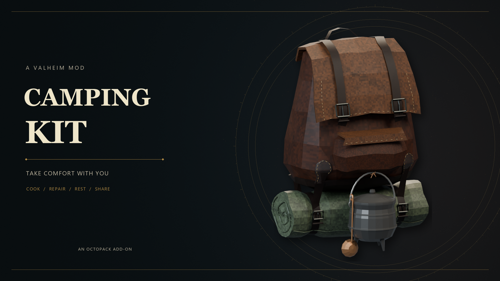
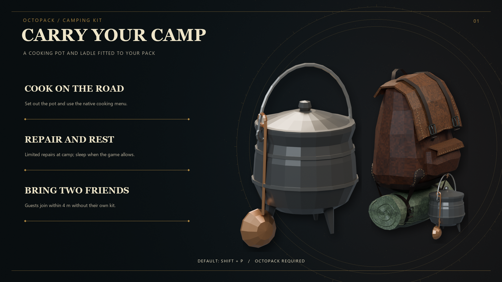
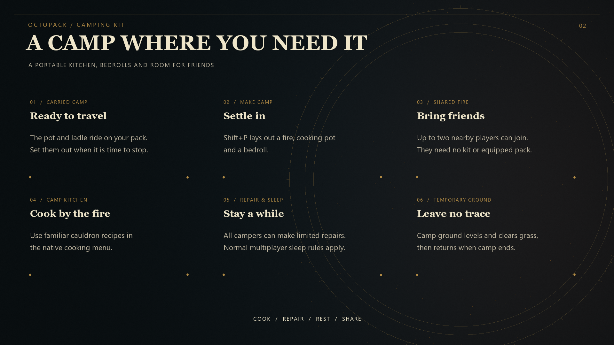

# OctoPack Camping Kit

Carry a cooking pot and ladle on your OctoPack, then make a temporary camp to cook, rest, and repair. Two nearby players can join your camp without bringing their own Camping Kit.

## Features

- Equip a pot and swinging ladle in an OctoPack accessory slot.
- Set up a shared camp with a fire, bedrolls, translucent soup, steam, and a cooking menu.
- Let up to two other players join within 4 metres. They share the fire and can repair and sleep; only the host needs an equipped Camping Kit.
- Temporarily level the campsite and clear grass while camping. The original terrain and ground clutter return when camp ends; the saved world terrain is unchanged.
- Repair each item once for 25% between other repairs. Sleep follows Valheim's multiplayer time rules.

## Controls

| Action | Default key |
| --- | --- |
| Make, join, or leave camp | Either Shift + P |
| Open cooking (host) | K |
| Repair (host or guest) | J |
| Sleep (host or guest) | L |

Joining a nearby camp takes priority over starting your own. Movement or threats cancel camping; when the host leaves, dies, or disconnects, the guest camp ends.

## Installation

Requires [OctoPack](https://thunderstore.io/c/valheim/p/Bascinet/OctoPack/) and BepInEx for Valheim. Install through a compatible mod manager, or close Valheim and copy the packaged `plugins` folder into `BepInEx`. The DLL belongs at `BepInEx/plugins/OctoPack_addon_Camping/OctoPack_addon_Camping.dll`.

Install the same Camping Kit version on every participating client. The host needs an equipped kit; guests do not need their own kit item or equipped backpack. Keep your existing config file when updating.

## Configuration

BepInEx creates `BepInEx/config/OctoPack_addon_Camping.cfg`. Settings include the camp, cooking, repair and sleep keys; pot and ladle mounting offsets; model scale; and swing motion.

## Notes

Camping Kit 0.1.19 includes a fix for cleanup during player shutdown. Automated build and regression checks passed. In-game quit-after-camping and multiplayer retesting are still pending for this build.

## Community and support

Join [OctoDad's Mods on Discord](https://discord.gg/RueyvSfX7R) for questions, bug reports, and news about future mods.

## Development disclosure

Developed with AI assistance from OpenAI Codex.

## Credits

Created by OctoDad / Bascinet.

